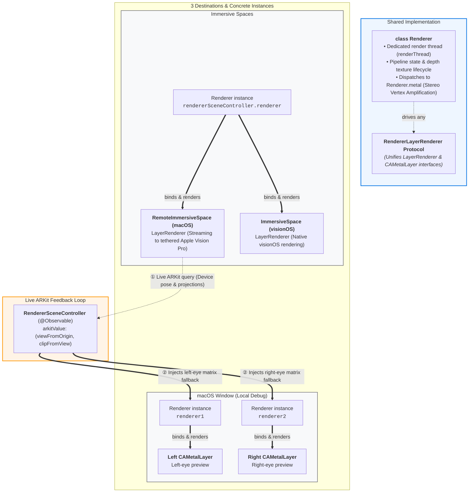

# MetalMacVision

  <a href="#japanese"><b>日本語</b></a> | <a href="#english"><b>English</b></a>

---

## 日本語

macOS 27 および visionOS 27 を前提とした、**`RemoteImmersiveSpace`** と **`CompositorServices`** による Metal 空間レンダリングの実験的 (PoC) プロジェクトです。

visionOS 実機／シミュレータだけでなく、macOS 上での `CAMetalLayer` プレビューや、Mac から Apple Vision Pro へのリモートイマーシブ配信に至るまで、共通の抽象化レイヤーで Metal 描画ループを駆動・デバッグできるパイプラインを検証しています。

### 🧪 実験テーマ & ハイライト

1. **共通クラス `Renderer` の複数インスタンスによる3つの適用先**
   - Metal 描画ループ・パイプライン構築・頂点シェーダー連携を担う実装クラス [`Renderer`](file:///Users/banjun/Library/Mobile%20Documents/com~apple~CloudDocs/projects/inbox/MetalMacVision/MetalMacVision/Renderer.swift) は完全に共通。
   - ターゲットごとに個別の `Renderer` インスタンスを持ち、共通プロトコル `RendererLayerRenderer` を通じて以下の3系統へ適用:
     - **`RemoteImmersiveSpace` (macOS)**: `rendererSceneController.renderer` がテザー接続された Vision Pro へのリモートイマーシブ描画を担当
     - **`ImmersiveSpace` (visionOS)**: 同一の `rendererSceneController.renderer` が Vision Pro 実機／シミュレータ上で直接描画
     - **`CAMetalLayer` (macOS デバッグ)**: Mac ウインドウ内の左眼用・右眼用ビューそれぞれに `renderer1` と `renderer2` を割り当て、ローカルプレビュー
2. **`RemoteImmersiveSpace` の ARKit トラッキング情報を `CAMetalLayer` へ注入**
   - Vision Pro から `ARKitSession` 経由でリアルタイム取得したデバイス姿勢・射影行列（`viewFromOrigin`, `clipFromView`）を、Mac 側のシーンコントローラー（`RendererSceneController`）にフィードバック。
   - その行列を Mac 上の左右デュアル `CAMetalLayer`（`renderer1`, `renderer2`）のフォールバック視点・射影として差し込み、**ヘッドセットの頭の動きにリアルタイム追従する Mac プレビュー** を実現。
3. **macOS 上での Dual `CAMetalLayer` ステレオ描画デバッグ**
   - Vision Pro 向け両眼描画（Vertex Amplification: `aid` を用いた左眼/右眼ビュー）を Mac 単体でも検証できるよう、左右の眼に対応するフォールバック射影・視点を持った CAMetalLayer を並列表示。
4. **[WIP] `RealityView` によるカメラ視点・デバッグ情報の可視化構想**
   - 現状は Orbit カメラを取り出して Metal のフォールバック行列として利用する構成ですが、将来的には Metal 側で使用しているカメラ位置やフラスタム（視体積）を 3D 空間上で客観的に図示・確認できるデバッグビューとしての活用を検討中です。

### 🏛 アーキテクチャ概要

### 📂 主要ファイル構成

| ファイル | 役割 |
| :--- | :--- |
| [`App.swift`](file:///Users/banjun/Library/Mobile%20Documents/com~apple~CloudDocs/projects/inbox/MetalMacVision/MetalMacVision/App.swift) | macOS の `RemoteImmersiveSpace` と visionOS の `ImmersiveSpace` のシーン定義と分岐。 |
| [`ContentView.swift`](file:///Users/banjun/Library/Mobile%20Documents/com~apple~CloudDocs/projects/inbox/MetalMacVision/MetalMacVision/ContentView.swift) | CAMetalLayer (左右デバッグ)、RealityView、ARKit 行列表示、リモートシーン制御ボタンを統合したメイン画面。 |
| [`RemoteSceneContent.swift`](file:///Users/banjun/Library/Mobile%20Documents/com~apple~CloudDocs/projects/inbox/MetalMacVision/MetalMacVision/RemoteSceneContent.swift) | `CompositorLayer` の構成 (`LayerRenderer.Configuration`) およびデバイス固有 `ARKitSession` の初期化。 |
| [`RendererLayerRenderer.swift`](file:///Users/banjun/Library/Mobile%20Documents/com~apple~CloudDocs/projects/inbox/MetalMacVision/MetalMacVision/RendererLayerRenderer.swift) | `LayerRenderer` と `CAMetalLayer` を単一インターフェースに統合するプロトコル定義。 |
| [`RendererDrawable.swift`](file:///Users/banjun/Library/Mobile%20Documents/com~apple~CloudDocs/projects/inbox/MetalMacVision/MetalMacVision/RendererDrawable.swift) | レンダーターゲット (`MTLTexture`)、射影・視点変換、提示 (`present`) の抽象化。 |
| [`RendererFrame.swift`](file:///Users/banjun/Library/Mobile%20Documents/com~apple~CloudDocs/projects/inbox/MetalMacVision/MetalMacVision/RendererFrame.swift) | フレームのタイミング待機 (`waitForOptimalInputTime`) とドローアブル取得の抽象化。 |
| [`Renderer.swift`](file:///Users/banjun/Library/Mobile%20Documents/com~apple~CloudDocs/projects/inbox/MetalMacVision/MetalMacVision/Renderer.swift) | メイン描画ループスレッドの管理、パイプライン構築、深度バッファ自動生成、ステレオレンダリングの共通実装。 |
| [`Renderer.metal`](file:///Users/banjun/Library/Mobile%20Documents/com~apple~CloudDocs/projects/inbox/MetalMacVision/MetalMacVision/Renderer.metal) | `amplification_id` に応じて左右眼用の座標変換を行う頂点シェーダー & フラグメントシェーダー。 |
| [`MetalLayer.swift`](file:///Users/banjun/Library/Mobile%20Documents/com~apple~CloudDocs/projects/inbox/MetalMacVision/MetalMacVision/MetalLayer.swift) | macOS SwiftUI で CAMetalLayer を扱うための `NSViewRepresentable` 実装。 |
| [`RendererSceneController.swift`](file:///Users/banjun/Library/Mobile%20Documents/com~apple~CloudDocs/projects/inbox/MetalMacVision/MetalMacVision/RendererSceneController.swift) | RealityView コンテンツと Metal レンダラー間のデータ連携・制御を行う `@Observable` クラス。 |

### ⚙️ 動作要件

- **macOS 27**
- **visionOS 27**
- **Xcode**

### 🚀 実行とデバッグ

#### macOS 単体実行
1. スキームを **MetalMacVision (macOS)** に切り替えて実行します。
2. ウインドウ上に以下の要素が表示されます:
   - **CAMetalLayer**: 左右のフォールバック視点に基づくステレオ Metal レンダリング。
   - **RealityView**: Orbit カメラ付き 3D ビュー。
   - **ARKit Values**: 現在の視点・射影変換行列。
3. Apple Vision Pro が接続されている場合、「Open Remote Scene」ボタンから Vision Pro 上で `RemoteImmersiveSpace` を展開できます。展開中は Vision Pro の頭部姿勢行列がリアルタイムに macOS の CAMetalLayer（`renderer1`, `renderer2`）にも差し込まれます。

#### visionOS 実行
1. スキームを **MetalMacVision (visionOS)** に切り替えて実行します。
2. ウインドウ上部のオーナメントから「Open Immersive Space」をタップすると、フルスペースでの CompositorServices 描画が起動します。

### 📝 実験ノート・気付き (Notes & Caveats)

- **RemoteImmersiveSpace のクリア深度**:
  - `RemoteImmersiveSpace` では `clearDepth` が 0 だと描画されない場合があり、Apple のサンプルコード (`CS_HoverEffect`) に倣って微小値（`1e-4`）を設定すると背景が抜けた状態での全ピクセル描画が安定します。
- **レイアウト構成**:
  - `LayerRenderer.Capabilities` の対応状況に応じて `.layered` か `.dedicated` かを動的に切り替えています。

---

## English

An experimental (proof-of-concept) project exploring **`RemoteImmersiveSpace`** and **`CompositorServices`** targeting **macOS 27** and **visionOS 27**.

This project investigates a unified spatial Metal rendering pipeline capable of driving and debugging frames across visionOS (device / simulator), local macOS `CAMetalLayer` previews, and remote immersive streaming from a Mac to an Apple Vision Pro.

### 🧪 Key Experiments & Highlights

1. **Shared `Renderer` Class Powering Three Separate Destinations**
   - The core [`Renderer`](file:///Users/banjun/Library/Mobile%20Documents/com~apple~CloudDocs/projects/inbox/MetalMacVision/MetalMacVision/Renderer.swift) implementation is shared across all targets, managing the dedicated render thread, pipeline states, depth buffer generation, and vertex amplification shaders.
   - Dedicated `Renderer` instances are instantiated for each destination through the unified `RendererLayerRenderer` protocol:
     - **`RemoteImmersiveSpace` (macOS)**: `rendererSceneController.renderer` drives immersive streaming to a tethered Apple Vision Pro.
     - **`ImmersiveSpace` (visionOS)**: The same `rendererSceneController.renderer` drives native visionOS CompositorServices rendering.
     - **`CAMetalLayer` (macOS debug preview)**: Separate instances (`renderer1` and `renderer2`) drive the left-eye and right-eye CAMetalLayers within the macOS window.
2. **Injecting Live Remote ARKit Matrices into Local `CAMetalLayer`**
   - Retrieves real-time device tracking poses and projection matrices (`viewFromOrigin`, `clipFromView`) from the Vision Pro via `ARKitSession`, published to [`RendererSceneController.swift`](file:///Users/banjun/Library/Mobile%20Documents/com~apple~CloudDocs/projects/inbox/MetalMacVision/MetalMacVision/RendererSceneController.swift).
   - Injects these matrices as the fallback view & projection providers of the local dual `CAMetalLayer` views (`renderer1`, `renderer2`), enabling **macOS previews that mirror the Vision Pro's physical head movements in real time**.
3. **Dual `CAMetalLayer` Stereo Debug Preview on macOS**
   - Side-by-side CAMetalLayers rendering left and right eyes using fallback device anchors and projections, allowing stereoscopic verification of vertex amplification shaders without needing a headset.
4. **[WIP] RealityView for Camera & Frustum Debug Visualization**
   - Currently, RealityView is primarily used to extract orbit camera matrices for fallback transforms. Looking ahead, it is intended to serve as a 3D debug canvas to visualize camera frustums, head poses, and spatial anchors alongside Metal rendering.

### 🏛 Architecture Overview

*(See the [Mermaid diagram](#🏛-アーキテクチャ概要) in the Japanese section above)*

### 📂 Key Files

| File | Description |
| :--- | :--- |
| [`App.swift`](file:///Users/banjun/Library/Mobile%20Documents/com~apple~CloudDocs/projects/inbox/MetalMacVision/MetalMacVision/App.swift) | Scene entry point branching between macOS `RemoteImmersiveSpace` and visionOS `ImmersiveSpace`. |
| [`ContentView.swift`](file:///Users/banjun/Library/Mobile%20Documents/com~apple~CloudDocs/projects/inbox/MetalMacVision/MetalMacVision/ContentView.swift) | Main window integrating dual CAMetalLayers, RealityView, ARKit matrix display, and remote scene controls. |
| [`RemoteSceneContent.swift`](file:///Users/banjun/Library/Mobile%20Documents/com~apple~CloudDocs/projects/inbox/MetalMacVision/MetalMacVision/RemoteSceneContent.swift) | Configures `CompositorLayer` (`LayerRenderer.Configuration`) and sets up device-specific `ARKitSession`. |
| [`RendererLayerRenderer.swift`](file:///Users/banjun/Library/Mobile%20Documents/com~apple~CloudDocs/projects/inbox/MetalMacVision/MetalMacVision/RendererLayerRenderer.swift) | Unified protocol definition bridging `LayerRenderer` and `CAMetalLayer`. |
| [`RendererDrawable.swift`](file:///Users/banjun/Library/Mobile%20Documents/com~apple~CloudDocs/projects/inbox/MetalMacVision/MetalMacVision/RendererDrawable.swift) | Abstraction for render targets (`MTLTexture`), projections, view transforms, and frame presentation. |
| [`RendererFrame.swift`](file:///Users/banjun/Library/Mobile%20Documents/com~apple~CloudDocs/projects/inbox/MetalMacVision/MetalMacVision/RendererFrame.swift) | Abstraction for frame pacing (`waitForOptimalInputTime`) and drawable acquisition. |
| [`Renderer.swift`](file:///Users/banjun/Library/Mobile%20Documents/com~apple~CloudDocs/projects/inbox/MetalMacVision/MetalMacVision/Renderer.swift) | Shared implementation of dedicated render thread, pipeline state management, auto depth texture generation, and draw commands. |
| [`Renderer.metal`](file:///Users/banjun/Library/Mobile%20Documents/com~apple~CloudDocs/projects/inbox/MetalMacVision/MetalMacVision/Renderer.metal) | Vertex shader using `amplification_id` for per-view stereo transformations and simple fragment shader. |
| [`MetalLayer.swift`](file:///Users/banjun/Library/Mobile%20Documents/com~apple~CloudDocs/projects/inbox/MetalMacVision/MetalMacVision/MetalLayer.swift) | `NSViewRepresentable` wrapping `CAMetalLayer` for macOS SwiftUI integration. |
| [`RendererSceneController.swift`](file:///Users/banjun/Library/Mobile%20Documents/com~apple~CloudDocs/projects/inbox/MetalMacVision/MetalMacVision/RendererSceneController.swift) | `@Observable` coordinator connecting RealityView content with the Metal renderer and ARKit updates. |

### ⚙️ Requirements

- **macOS 27**
- **visionOS 27**
- **Xcode**

### 🚀 Running & Debugging

#### macOS
1. Switch scheme to **MetalMacVision (macOS)** and run.
2. The window displays:
   - **CAMetalLayer**: Stereoscopic Metal render preview using fallback transforms.
   - **RealityView**: 3D view with orbit camera controls.
   - **ARKit Values**: Real-time view and projection matrices.
3. When an Apple Vision Pro is connected, click **"Open Remote Scene"** to present the `RemoteImmersiveSpace` on the headset. The live tracking matrices will seamlessly inject into the local CAMetalLayer views (`renderer1` and `renderer2`).

#### visionOS
1. Switch scheme to **MetalMacVision (visionOS)** and run.
2. Tap **"Open Immersive Space"** on the window ornament to launch full CompositorServices rendering.

### 📝 Notes & Caveats

- **RemoteImmersiveSpace Clear Depth**:
  - In `RemoteImmersiveSpace`, setting `clearDepth` to `0` may result in empty frames. Using a small epsilon (`1e-4`, following Apple's `CS_HoverEffect` sample) ensures stable drawing with transparency preserved.
- **Layout Configuration**:
  - Dynamically selects `.layered` or `.dedicated` based on available `LayerRenderer.Capabilities`.
