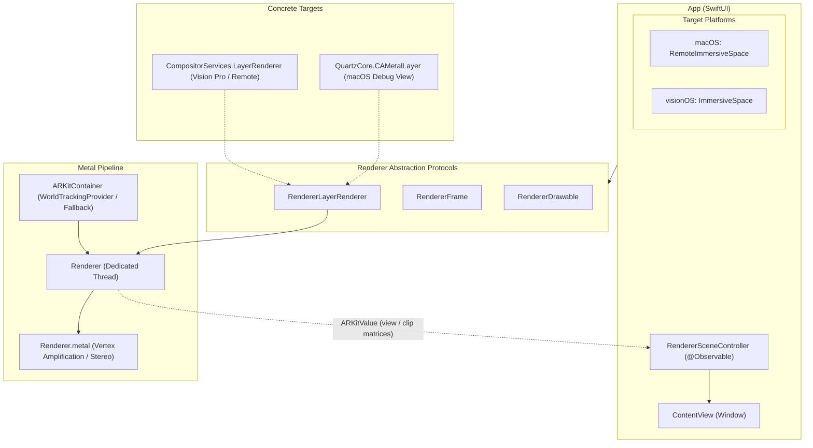

# MetalMacVision

  <a href="#japanese"><b>日本語</b></a> | <a href="#english"><b>English</b></a>

---

## 日本語

macOS 27 および visionOS 27 を前提とした、**`RemoteImmersiveSpace`** と **`CompositorServices`** による Metal 空間レンダリングの実験的 (PoC) プロジェクトです。

visionOS 実機／シミュレータだけでなく、macOS 上での `CAMetalLayer` プレビューや、Mac から Apple Vision Pro へのリモートイマーシブ配信に至るまで、共通の抽象化レイヤーで Metal 描画ループを駆動・デバッグできるパイプラインを検証しています。

### 🧪 実験テーマ & ハイライト

1. **`LayerRenderer` と `CAMetalLayer` のプロトコル統一抽象化**
   - [`CompositorServices.LayerRenderer`](file:///Users/banjun/Library/Mobile%20Documents/com~apple~CloudDocs/projects/inbox/MetalMacVision/MetalMacVision/RendererLayerRenderer.swift) と [`QuartzCore.CAMetalLayer`](file:///Users/banjun/Library/Mobile%20Documents/com~apple~CloudDocs/projects/inbox/MetalMacVision/MetalMacVision/RendererLayerRenderer.swift) を、共通プロトコル（[`RendererLayerRenderer`](file:///Users/banjun/Library/Mobile%20Documents/com~apple~CloudDocs/projects/inbox/MetalMacVision/MetalMacVision/RendererLayerRenderer.swift), [`RendererFrame`](file:///Users/banjun/Library/Mobile%20Documents/com~apple~CloudDocs/projects/inbox/MetalMacVision/MetalMacVision/RendererFrame.swift), [`RendererDrawable`](file:///Users/banjun/Library/Mobile%20Documents/com~apple~CloudDocs/projects/inbox/MetalMacVision/MetalMacVision/RendererDrawable.swift)）でラップ。
   - バックエンドの違いを隠蔽し、同一の Metal レンダラー（[`Renderer.swift`](file:///Users/banjun/Library/Mobile%20Documents/com~apple~CloudDocs/projects/inbox/MetalMacVision/MetalMacVision/Renderer.swift)）および専用描画スレッドからフレーム送信を実行。

2. **macOS `RemoteImmersiveSpace` によるリモート配信**
   - macOS アプリから Apple Vision Pro をテザー接続し、[`RemoteDeviceIdentifier`](file:///Users/banjun/Library/Mobile%20Documents/com~apple~CloudDocs/projects/inbox/MetalMacVision/MetalMacVision/RemoteSceneContent.swift) を介して `ARKitSession(device: ...)` と `CompositorLayer` を起動。
   - Mac 上で実行した Metal 描画をリモートのイマーシブ空間へストリーミング。

3. **トラッキング情報（ARKit）の連携 & リアルタイム可視化**
   - Vision Pro から取得したデバイス姿勢（`originFromAnchorTransform`）およびプロジェクション情報から算出される `viewFromOrigin` / `clipFromView` 行列を macOS 側の UI（[`Matrix.swift`](file:///Users/banjun/Library/Mobile%20Documents/com~apple~CloudDocs/projects/inbox/MetalMacVision/MetalMacVision/Matrix.swift)）へリアルタイム反映・数値表示。

4. **macOS 上での Dual `CAMetalLayer` ステレオ描画デバッグ**
   - Vision Pro 向け両眼描画（Vertex Amplification: `aid` を用いた左眼/右眼ビュー）を Mac 単体でも検証できるよう、左右の眼に対応するフォールバック射影・視点を持った CAMetalLayer を並列表示。

5. **`RealityView` と Metal レイヤーの共存**
   - SwiftUI 上で Orbit カメラ付き [`RealityView`](file:///Users/banjun/Library/Mobile%20Documents/com~apple~CloudDocs/projects/inbox/MetalMacVision/MetalMacVision/RealityView+.swift) と Metal プレビューを同時に配置し、シーンコントローラー（[`RendererSceneController.swift`](file:///Users/banjun/Library/Mobile%20Documents/com~apple~CloudDocs/projects/inbox/MetalMacVision/MetalMacVision/RendererSceneController.swift)）を介して状態を同期。

### 🏛 アーキテクチャ概要

### 📂 主要ファイル構成

| ファイル | 役割 |
| :--- | :--- |
| [`App.swift`](file:///Users/banjun/Library/Mobile%20Documents/com~apple~CloudDocs/projects/inbox/MetalMacVision/MetalMacVision/App.swift) | macOS の `RemoteImmersiveSpace` と visionOS の `ImmersiveSpace` のシーン定義と分岐。 |
| [`ContentView.swift`](file:///Users/banjun/Library/Mobile%20Documents/com~apple~CloudDocs/projects/inbox/MetalMacVision/MetalMacVision/ContentView.swift) | CAMetalLayer (左右デバッグ)、RealityView、ARKit 行列表示、リモートシーン制御ボタンを統合したメイン画面。 |
| [`RemoteSceneContent.swift`](file:///Users/banjun/Library/Mobile%20Documents/com~apple~CloudDocs/projects/inbox/MetalMacVision/MetalMacVision/RemoteSceneContent.swift) | `CompositorLayer` の構成 (`LayerRenderer.Configuration`) およびデバイス固有 `ARKitSession` の初期化。 |
| [`RendererLayerRenderer.swift`](file:///Users/banjun/Library/Mobile%20Documents/com~apple~CloudDocs/projects/inbox/MetalMacVision/MetalMacVision/RendererLayerRenderer.swift) | `LayerRenderer` と `CAMetalLayer` を単一インターフェースに統合するプロトコル定義。 |
| [`RendererDrawable.swift`](file:///Users/banjun/Library/Mobile%20Documents/com~apple~CloudDocs/projects/inbox/MetalMacVision/MetalMacVision/RendererDrawable.swift) | レンダーターゲット (`MTLTexture`)、射影・視点変換、提示 (`present`) の抽象化。 |
| [`RendererFrame.swift`](file:///Users/banjun/Library/Mobile%20Documents/com~apple~CloudDocs/projects/inbox/MetalMacVision/MetalMacVision/RendererFrame.swift) | フレームのタイミング待機 (`waitForOptimalInputTime`) とドローアブル取得の抽象化。 |
| [`Renderer.swift`](file:///Users/banjun/Library/Mobile%20Documents/com~apple~CloudDocs/projects/inbox/MetalMacVision/MetalMacVision/Renderer.swift) | メイン描画ループスレッドの管理、パイプライン構築、深度バッファ自動生成、ステレオレンダリングの実行。 |
| [`Renderer.metal`](file:///Users/banjun/Library/Mobile%20Documents/com~apple~CloudDocs/projects/inbox/MetalMacVision/MetalMacVision/Renderer.metal) | `amplification_id` に応じて左右眼用の座標変換を行う頂点シェーダー & フラグメントシェーダー。 |
| [`MetalLayer.swift`](file:///Users/banjun/Library/Mobile%20Documents/com~apple~CloudDocs/projects/inbox/MetalMacVision/MetalMacVision/MetalLayer.swift) | macOS SwiftUI で CAMetalLayer を扱うための `NSViewRepresentable` 実装。 |
| [`RendererSceneController.swift`](file:///Users/banjun/Library/Mobile%20Documents/com~apple~CloudDocs/projects/inbox/MetalMacVision/MetalMacVision/RendererSceneController.swift) | RealityView コンテンツと Metal レンダラー間のデータ連携・制御を行う `@Observable` クラス。 |

### ⚙️ 動作要件

- **macOS 27**
- **visionOS 27**
- **Xcode**

### 🚀 実行とデバッグ

#### macOS 単体実行
1. スキームを **MetalMacVision (macOS)** に切り替えて実行します。
2. ウインドウ上に以下の要素が表示されます:
   - **CAMetalLayer**: 左右のフォールバック視点に基づくステレオ Metal レンダリング。
   - **RealityView**: Orbit 操作可能な 3D シーン（立方体モデル）。
   - **ARKit Values**: 現在の視点・射影変換行列。
3. Apple Vision Pro が接続されている場合、「Open Remote Scene」ボタンから Vision Pro 上で `RemoteImmersiveSpace` を展開できます。

#### visionOS 実行
1. スキームを **MetalMacVision (visionOS)** に切り替えて実行します。
2. ウインドウ上部のオーナメントから「Open Immersive Space」をタップすると、フルスペースでの CompositorServices 描画が起動します。

### 📝 実験ノート・気付き (Notes & Caveats)

- **RemoteImmersiveSpace のクリア深度**:
  - `RemoteImmersiveSpace` では `clearDepth` が 0 だと描画されない場合があり、Apple のサンプルコード (`CS_HoverEffect`) に倣って微小値（`1e-4`）を設定すると背景が抜けた状態での全ピクセル描画が安定します。
- **レイアウト構成**:
  - `LayerRenderer.Capabilities` の対応状況に応じて `.layered` か `.dedicated` かを動的に切り替えています。

---

## English

An experimental (proof-of-concept) project exploring **`RemoteImmersiveSpace`** and **`CompositorServices`** targeting **macOS 27** and **visionOS 27**.

This project investigates a unified spatial Metal rendering pipeline capable of driving and debugging frames across visionOS (device / simulator), local macOS `CAMetalLayer` previews, and remote immersive streaming from a Mac to an Apple Vision Pro.

### 🧪 Key Experiments & Highlights

1. **Unified Abstraction for `LayerRenderer` & `CAMetalLayer`**
   - Wraps both [`CompositorServices.LayerRenderer`](file:///Users/banjun/Library/Mobile%20Documents/com~apple~CloudDocs/projects/inbox/MetalMacVision/MetalMacVision/RendererLayerRenderer.swift) and [`QuartzCore.CAMetalLayer`](file:///Users/banjun/Library/Mobile%20Documents/com~apple~CloudDocs/projects/inbox/MetalMacVision/MetalMacVision/RendererLayerRenderer.swift) under common protocols ([`RendererLayerRenderer`](file:///Users/banjun/Library/Mobile%20Documents/com~apple~CloudDocs/projects/inbox/MetalMacVision/MetalMacVision/RendererLayerRenderer.swift), [`RendererFrame`](file:///Users/banjun/Library/Mobile%20Documents/com~apple~CloudDocs/projects/inbox/MetalMacVision/MetalMacVision/RendererFrame.swift), [`RendererDrawable`](file:///Users/banjun/Library/Mobile%20Documents/com~apple~CloudDocs/projects/inbox/MetalMacVision/MetalMacVision/RendererDrawable.swift)).
   - Hides backend differences so that the same Metal renderer ([`Renderer.swift`](file:///Users/banjun/Library/Mobile%20Documents/com~apple~CloudDocs/projects/inbox/MetalMacVision/MetalMacVision/Renderer.swift)) on a dedicated render thread drives submission to either surface.

2. **macOS `RemoteImmersiveSpace` Streaming**
   - Connects to an Apple Vision Pro from macOS using [`RemoteDeviceIdentifier`](file:///Users/banjun/Library/Mobile%20Documents/com~apple~CloudDocs/projects/inbox/MetalMacVision/MetalMacVision/RemoteSceneContent.swift) to launch `ARKitSession(device: ...)` and `CompositorLayer`.
   - Streams Metal-rendered frames from the Mac directly into the remote immersive space.

3. **ARKit Head Tracking & Live Visualization**
   - Retrieves device tracking poses (`originFromAnchorTransform`) and projection data from the Vision Pro, continuously publishing `viewFromOrigin` and `clipFromView` matrices to the macOS UI ([`Matrix.swift`](file:///Users/banjun/Library/Mobile%20Documents/com~apple~CloudDocs/projects/inbox/MetalMacVision/MetalMacVision/Matrix.swift)) for live numerical inspection.

4. **Dual `CAMetalLayer` Stereo Debug Preview on macOS**
   - Side-by-side CAMetalLayers rendering left and right eyes using fallback device anchors and projections, allowing stereoscopic verification of vertex amplification shaders without needing a headset.

5. **RealityView & Metal Coexistence**
   - Hosts a [`RealityView`](file:///Users/banjun/Library/Mobile%20Documents/com~apple~CloudDocs/projects/inbox/MetalMacVision/MetalMacVision/RealityView+.swift) with orbit camera controls alongside Metal views in SwiftUI, synchronized via [`RendererSceneController.swift`](file:///Users/banjun/Library/Mobile%20Documents/com~apple~CloudDocs/projects/inbox/MetalMacVision/MetalMacVision/RendererSceneController.swift).

### 🏛 Architecture Overview

*(See the [Mermaid diagram](#🏛-アーキテクチャ概要) in the Japanese section above)*

### 📂 Key Files

| File | Description |
| :--- | :--- |
| [`App.swift`](file:///Users/banjun/Library/Mobile%20Documents/com~apple~CloudDocs/projects/inbox/MetalMacVision/MetalMacVision/App.swift) | Scene entry point branching between macOS `RemoteImmersiveSpace` and visionOS `ImmersiveSpace`. |
| [`ContentView.swift`](file:///Users/banjun/Library/Mobile%20Documents/com~apple~CloudDocs/projects/inbox/MetalMacVision/MetalMacVision/ContentView.swift) | Main window integrating dual CAMetalLayers, RealityView, ARKit matrix display, and remote scene controls. |
| [`RemoteSceneContent.swift`](file:///Users/banjun/Library/Mobile%20Documents/com~apple~CloudDocs/projects/inbox/MetalMacVision/MetalMacVision/RemoteSceneContent.swift) | Configures `CompositorLayer` (`LayerRenderer.Configuration`) and sets up device-specific `ARKitSession`. |
| [`RendererLayerRenderer.swift`](file:///Users/banjun/Library/Mobile%20Documents/com~apple~CloudDocs/projects/inbox/MetalMacVision/MetalMacVision/RendererLayerRenderer.swift) | Unified protocol definition bridging `LayerRenderer` and `CAMetalLayer`. |
| [`RendererDrawable.swift`](file:///Users/banjun/Library/Mobile%20Documents/com~apple~CloudDocs/projects/inbox/MetalMacVision/MetalMacVision/RendererDrawable.swift) | Abstraction for render targets (`MTLTexture`), projections, view transforms, and frame presentation. |
| [`RendererFrame.swift`](file:///Users/banjun/Library/Mobile%20Documents/com~apple~CloudDocs/projects/inbox/MetalMacVision/MetalMacVision/RendererFrame.swift) | Abstraction for frame pacing (`waitForOptimalInputTime`) and drawable acquisition. |
| [`Renderer.swift`](file:///Users/banjun/Library/Mobile%20Documents/com~apple~CloudDocs/projects/inbox/MetalMacVision/MetalMacVision/Renderer.swift) | Dedicated render loop thread, pipeline state management, auto depth texture generation, and draw commands. |
| [`Renderer.metal`](file:///Users/banjun/Library/Mobile%20Documents/com~apple~CloudDocs/projects/inbox/MetalMacVision/MetalMacVision/Renderer.metal) | Vertex shader using `amplification_id` for per-view stereo transformations and simple fragment shader. |
| [`MetalLayer.swift`](file:///Users/banjun/Library/Mobile%20Documents/com~apple~CloudDocs/projects/inbox/MetalMacVision/MetalMacVision/MetalLayer.swift) | `NSViewRepresentable` wrapping `CAMetalLayer` for macOS SwiftUI integration. |
| [`RendererSceneController.swift`](file:///Users/banjun/Library/Mobile%20Documents/com~apple~CloudDocs/projects/inbox/MetalMacVision/MetalMacVision/RendererSceneController.swift) | `@Observable` coordinator connecting RealityView content with the Metal renderer and ARKit updates. |

### ⚙️ Requirements

- **macOS 27**
- **visionOS 27**
- **Xcode**

### 🚀 Running & Debugging

#### macOS
1. Switch scheme to **MetalMacVision (macOS)** and run.
2. The window displays:
   - **CAMetalLayer**: Stereoscopic Metal render preview using fallback transforms.
   - **RealityView**: 3D interactive scene with orbit camera controls.
   - **ARKit Values**: Real-time view and projection matrices.
3. When an Apple Vision Pro is connected, click **"Open Remote Scene"** to present the `RemoteImmersiveSpace` on the headset.

#### visionOS
1. Switch scheme to **MetalMacVision (visionOS)** and run.
2. Tap **"Open Immersive Space"** on the window ornament to launch full CompositorServices rendering.

### 📝 Notes & Caveats

- **RemoteImmersiveSpace Clear Depth**:
  - In `RemoteImmersiveSpace`, setting `clearDepth` to `0` may result in empty frames. Using a small epsilon (`1e-4`, following Apple's `CS_HoverEffect` sample) ensures stable drawing with transparency preserved.
- **Layout Configuration**:
  - Dynamically selects `.layered` or `.dedicated` based on available `LayerRenderer.Capabilities`.
